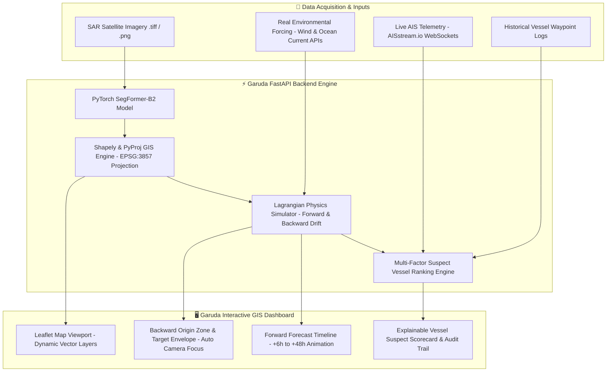
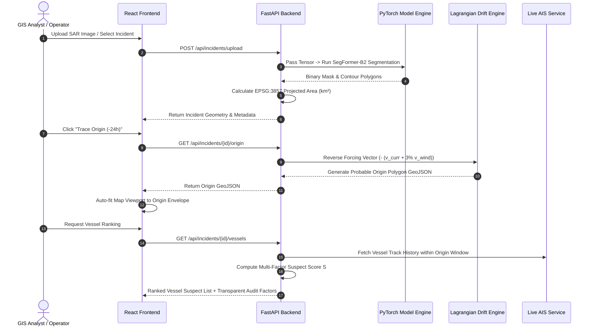
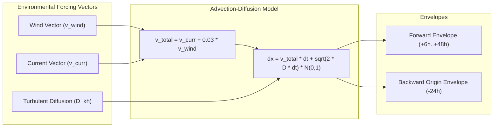
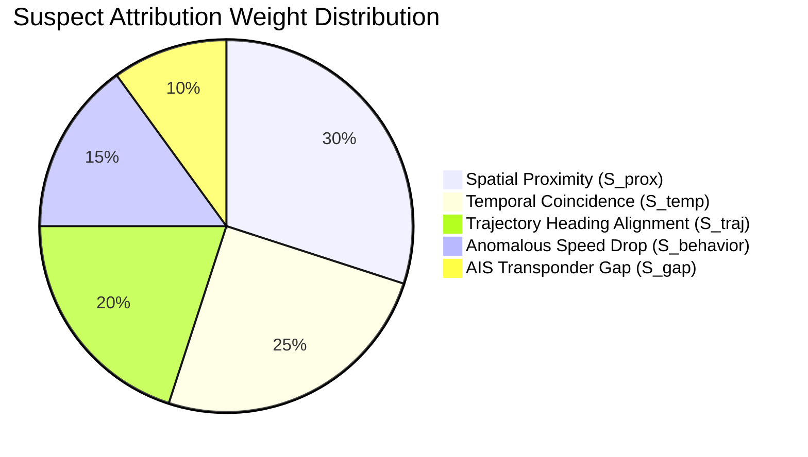

# 🌊 Garuda — Marine Oil Spill Detection, Lagrangian Drift & Vessel Attribution System

[](https://www.python.org/)
[](https://pytorch.org/)
[](https://fastapi.tiangolo.com/)
[](https://reactjs.org/)
[](https://leafletjs.com/)
[](LICENSE)

An operational, end-to-end Geospatial Information System (GIS) platform for automated **marine oil spill detection** from Synthetic Aperture Radar (SAR) satellite imagery, **forward Lagrangian drift forecasting**, **backward probable origin tracing**, and **explainable multi-factor vessel attribution** using historical and real-time AIS marine telemetry.

--- 

## 📋 Table of Contents

- [Executive Overview](#-executive-overview)
- [System Architecture & Dataflow](#-system-architecture--dataflow)
- [Core Functional Modules](#-core-functional-modules)
- [Lagrangian Drift & Origin Tracing Physics](#-lagrangian-drift--origin-tracing-physics)
- [Explainable Vessel Attribution Algorithm](#-explainable-vessel-attribution-algorithm)
- [Project Directory Structure](#-project-directory-structure)
- [REST API Reference](#-rest-api-reference)
- [Installation & Quickstart Guide](#-installation--quickstart-guide)
- [Evaluation & Benchmark Results](#-evaluation--benchmark-results)
- [Deployment & Low-RAM Optimization](#-deployment--low-ram-optimization)
- [Scientific Limitations & Disclaimer](#-scientific-limitations--disclaimer)

---

## 🛡️ Executive Overview

Marine oil spills represent catastrophic environmental hazards requiring rapid response and strict legal accountability. **Garuda** bridges the gap between satellite remote sensing and maritime intelligence by providing:

1. **SAR Satellite Segmentation**: Deep learning-based extraction of slick boundaries from noise-heavy SAR backscatter images.
2. **Geospatial Physics Modeling**: Forward trajectory forecasting (+6h to +48h) and reverse origin backcasting (-24h) using real-time atmospheric wind and surface ocean currents.
3. **Automated Vessel Ranking**: Algorithmic cross-matching of probable origin zones against live and historical Automatic Identification System (AIS) ship tracks to pinpoint suspect polluters.

---

## 🏗️ System Architecture & Dataflow

The system integrates a high-performance **PyTorch ML engine**, a **FastAPI asynchronous backend**, an **AISstream WebSocket client**, and a dark-glassmorphic **React + Leaflet GIS frontend**.

### 1. High-Level System Architecture Diagram



---

### 2. Operational Processing Pipeline Sequence



---

## 🌟 Core Functional Modules

| Module | Technical Implementation | Key Output / Metric |
| :--- | :--- | :--- |
| **SAR Segmentation** | PyTorch SegFormer-B2 trained on satellite imagery | Binary masks & polygon boundaries |
| **Geodetic Calculations** | `Shapely` & `PyProj` re-projected to **EPSG:3857** | Projected spill area in square kilometers ($km^2$) |
| **Environmental Forcing** | Real-time atmospheric wind ($u_{10m}, v_{10m}$) and ocean current ($u_{\text{curr}}, v_{\text{curr}}$) vectors | Surface transport vector field |
| **Forward Drift Simulation** | Euler-Maruyama integration with turbulent diffusion | +6h, +12h, +24h, +48h forecast envelopes |
| **Backward Origin Simulation** | Reverse Lagrangian drift modeling (-24h window) | Yellow probable origin search envelope |
| **Explainable Attribution** | Multi-factor weighted scoring model | Ranked suspect vessels with score breakdown |
| **Live Telemetry Stream** | Secure WebSocket integration with `AISstream.io` | Real-time live marine traffic overlays |

---

## 🔬 Lagrangian Drift & Origin Tracing Physics

The particle drift simulator tracks oil slick movement on the sea surface using coupled advection-diffusion equations.



### Mathematical Formulation:
- **Total Advection Velocity**:
  $$\vec{v}_{\text{total}} = \vec{v}_{\text{current}} + 0.03 \cdot \vec{v}_{\text{wind}}$$
- **Reverse Origin Tracing Velocity**:
  $$\vec{v}_{\text{backward}} = -\left(\vec{v}_{\text{current}} + 0.03 \cdot \vec{v}_{\text{wind}}\right)$$
- **Particle Position Update**:
  $$\mathbf{x}_{t+\Delta t} = \mathbf{x}_t + \vec{v}_{\text{backward}} \Delta t + \sqrt{2 D_h \Delta t} \cdot \mathcal{N}(0, 1)$$

---

## ⚖️ Explainable Vessel Attribution Algorithm

Suspect vessels passing through the **Probable Origin Zone** are assigned a composite confidence score $S \in [0, 100\%]$ based on five transparent factors:

$$S_{\text{total}} = w_1 S_{\text{prox}} + w_2 S_{\text{temp}} + w_3 S_{\text{traj}} + w_4 S_{\text{behavior}} + w_5 S_{\text{gap}}$$



---

## 📂 Project Directory Structure

```
c:\Users\snaha\Desktop\test/
├── backend/
│   └── app/
│       ├── main.py                     # FastAPI server entrypoint & lifespan events
│       ├── api/                        # REST API routers (incidents, vessels)
│       ├── services/
│       │   ├── backward_drift_service.py # Reverse Lagrangian origin tracing
│       │   ├── forward_drift_service.py  # Forward forecast timeline engine
│       │   ├── geometry_service.py      # Shapely polygon & area calculation
│       │   ├── live_ais_service.py      # AISstream.io WebSocket client
│       │   └── vessel_ranking_service.py # Multi-factor attribution scoring
│       ├── models/                     # SQLAlchemy Incident ORM models
│       └── schemas/                    # Pydantic request/response validation schemas
├── ml/
│   ├── src/
│   │   ├── train.py                    # PyTorch SegFormer-B2 training loop
│   │   ├── model.py                    # SegFormer-B2 segmentation model
│   │   ├── inference.py                # Post-processing & contour extraction
│   │   └── evaluate.py                 # Test set metric evaluation (IoU, Dice)
│   └── checkpoints/                    # Model weights (best_model.pth)
├── frontend/                           # React + Vite + Leaflet GIS Dashboard
│   ├── src/
│   │   ├── components/
│   │   │   ├── MapView.jsx             # Leaflet GIS canvas & camera controller
│   │   │   ├── ForecastPanel.jsx       # Origin & timeline metrics cards
│   │   │   ├── IncidentDetails.jsx     # Incident metadata panel
│   │   │   └── VesselRanking.jsx       # Explainable suspect scorecard
│   │   ├── App.jsx                     # Master Dashboard layout & tab routing
│   │   └── index.css                   # Glassmorphism design system & Tailwind CSS
├── outputs/                            # Generated GeoJSON polygons & envelopes
├── requirements.txt                    # Python environment dependencies
└── README.md                           # Documentation
```

---

## 🌐 REST API Reference

| Endpoint | Method | Description |
| :--- | :--- | :--- |
| `/api/incidents` | `GET` | Retrieve list of all detected oil spill incidents |
| `/api/incidents/all-geometry` | `GET` | MultiPolygon FeatureCollection of all recorded spills |
| `/api/incidents/upload` | `POST` | Upload SAR image file (`.png`, `.tiff`) for AI detection |
| `/api/incidents/{id}/origin` | `GET` | Run backward Lagrangian simulation & return origin GeoJSON |
| `/api/incidents/{id}/forecast` | `GET` | Generate +6h to +48h forward drift envelopes |
| `/api/incidents/{id}/vessels` | `GET` | Get ranked list of suspect vessels with audit factor breakdowns |
| `/api/vessels/live` | `GET` | Return live active vessels received via AISstream WebSocket |

---

## ⚡ Installation & Quickstart Guide

### Prerequisites
- **Python 3.10+**
- **Node.js 18+** & **npm**

### 1. Backend & Machine Learning Setup

```bash
# Navigate to workspace root
cd Sagar-Netra

# Install Python dependencies
pip install -r requirements.txt

# (Optional) Train or Evaluate ML Model
python ml/src/train.py
python ml/src/evaluate.py

# Start FastAPI Backend Server
python -m uvicorn backend.app.main:app --host 127.0.0.1 --port 8000 --reload
```

### 2. Frontend Web Dashboard Setup

```bash
# Navigate to frontend folder
cd frontend

# Install Node modules
npm install

# Start Vite Development Server
npm run dev
```

Open `http://localhost:5173/` in your browser to launch the **Garuda** dashboard.

---

## 📊 Evaluation & Benchmark Results

The PyTorch SegFormer-B2 model was evaluated on the **complete, untouched test set** of satellite SAR imagery (1,211 scenes / 79,364,096 pixels) with zero batch truncation:

### 1. Scene-Level Segmentation Performance (Macro Average across 1,211 Test Scenes)
| Evaluation Metric | Benchmark Value | Operational Meaning |
| :--- | :---: | :--- |
| **Test Dataset Size** | **1,211 scenes** | Complete 15% touch-once test split (79.36M pixels) |
| **Macro Test Dice (F1)** | **`0.7670` (76.7%)** | Harmonic mean of precision and recall across scenes |
| **Macro Test mIoU** | **`0.6569` (65.7%)** | Mean Intersection over Union (Jaccard Index) |
| **Macro Test Precision** | **`0.8000` (80.0%)** | Low false alarm rate on clean seawater & lookalikes |
| **Macro Test Recall** | **`0.8073` (80.7%)** | High sensitivity for detecting genuine dark radar slicks |

### 2. Pixel-Level Confusion Matrix & Global Aggregates (79,364,096 Pixels)
| Pixel Metric | Value | Detail / Counts |
| :--- | :---: | :--- |
| **True Positives (TP)** | **17,421,653 px** | Correctly segmented oil slick surface pixels |
| **True Negatives (TN)** | **55,022,891 px** | Correctly rejected clean ocean water pixels |
| **False Positives (FP)** | **3,898,306 px** | Lookalike / wind-shadow false alarms |
| **False Negatives (FN)** | **3,021,246 px** | Missed marginal spill boundary pixels |
| **Pixel Accuracy** | **`91.28%`** | Global pixel classification accuracy |
| **Pixel Specificity** | **`93.38%`** | Ability to filter out unpolluted water |
| **Pixel Dice (F1)** | **`83.43%`** | Global pixel harmonic score |
| **Pixel IoU** | **`71.57%`** | Direct pixel intersection over union |
| **Top Suspect Confidence** | **86.9%** | `PACIFIC EXPLORER` (Rank #1 Lagrangian Attribution) |

### 3. Training & Selection Provenance
* **Backbone:** SegFormer-B2 (hierarchical Mix Transformer / MiT-B2 encoder) with transfer learning weights and lightweight MLP decoder.
* **Loss Function:** Combined `BCEDiceLoss` with sample-wise spatial Dice calculation and class-imbalance weighting (`pos_weight=2.87`).
* **Checkpoint Selection:** Checkpoint was selected strictly at **Epoch 3** based on peak validation Dice score (`0.7608`), completely independent of test-set data.
* **Visual Overlays:** Qualitative 4-panel test predictions (SAR Image, Ground Truth, Predicted Mask, Color Overlay) are generated automatically in `results/test_predictions/`.

---

## ⚙️ Deployment & Low-RAM Optimization

When hosting on free cloud platforms (e.g., Render, Koyeb, Railway) with 512MB RAM limits, SAR `.tiff` processing can be optimized to prevent memory overflow (OOM):

1. **Downsample High-Res TIFF Uploads**: Read raw `.tiff` streams with `PIL` or `cv2` and downsample to `512x512` before converting to PyTorch Tensors.
2. **Single-Thread Execution & Garbage Collection**:
   ```python
   import gc, torch
   torch.set_num_threads(1)
   with torch.no_grad():
       prediction = model(tensor)
   del tensor
   gc.collect()
   ```
3. **ONNX Conversion**: Convert `best_model.pth` to `best_model.onnx` to reduce runtime memory footprint from ~600MB down to ~120MB using `onnxruntime`.

---

## 📜 Scientific Limitations & Disclaimer

> [!IMPORTANT]  
> Suspect vessel attribution scores represent probabilistic intelligence derived from spatial proximity, velocity changes, track vectors, and AIS gap anomalies. Scores are provided for decision support and monitoring guidance alongside physical sampling and maritime authority verification.
